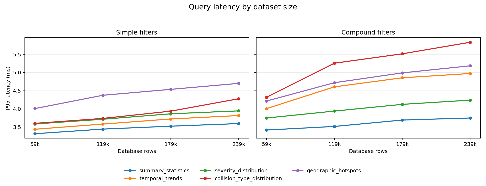

# Filter Query Latency

| Scale | Rows | Query | Query Type | P95 (ms) | Max (ms) |
|---:|---:|---|---|---:|---:|
| 25% | 59,897 | summary_statistics | simple | 3.316 | 3.359 |
| 25% | 59,897 | summary_statistics | compound | 3.417 | 3.537 |
| 25% | 59,897 | temporal_trends | simple | 3.439 | 3.475 |
| 25% | 59,897 | temporal_trends | compound | 4.006 | 4.094 |
| 25% | 59,897 | severity_distribution | simple | 3.584 | 3.626 |
| 25% | 59,897 | severity_distribution | compound | 3.748 | 3.799 |
| 25% | 59,897 | collision_type_distribution | simple | 3.601 | 3.670 |
| 25% | 59,897 | collision_type_distribution | compound | 4.318 | 4.409 |
| 25% | 59,897 | geographic_hotspots | simple | 4.008 | 4.103 |
| 25% | 59,897 | geographic_hotspots | compound | 4.215 | 4.272 |
| 50% | 119,794 | summary_statistics | simple | 3.443 | 3.610 |
| 50% | 119,794 | summary_statistics | compound | 3.516 | 3.721 |
| 50% | 119,794 | temporal_trends | simple | 3.581 | 3.750 |
| 50% | 119,794 | temporal_trends | compound | 4.606 | 4.776 |
| 50% | 119,794 | severity_distribution | simple | 3.714 | 3.867 |
| 50% | 119,794 | severity_distribution | compound | 3.939 | 4.060 |
| 50% | 119,794 | collision_type_distribution | simple | 3.737 | 3.969 |
| 50% | 119,794 | collision_type_distribution | compound | 5.257 | 5.747 |
| 50% | 119,794 | geographic_hotspots | simple | 4.374 | 4.662 |
| 50% | 119,794 | geographic_hotspots | compound | 4.720 | 4.852 |
| 75% | 179,691 | summary_statistics | simple | 3.523 | 3.598 |
| 75% | 179,691 | summary_statistics | compound | 3.692 | 3.760 |
| 75% | 179,691 | temporal_trends | simple | 3.722 | 3.827 |
| 75% | 179,691 | temporal_trends | compound | 4.855 | 4.888 |
| 75% | 179,691 | severity_distribution | simple | 3.864 | 3.912 |
| 75% | 179,691 | severity_distribution | compound | 4.124 | 4.195 |
| 75% | 179,691 | collision_type_distribution | simple | 3.937 | 3.974 |
| 75% | 179,691 | collision_type_distribution | compound | 5.515 | 5.554 |
| 75% | 179,691 | geographic_hotspots | simple | 4.537 | 4.647 |
| 75% | 179,691 | geographic_hotspots | compound | 4.990 | 5.049 |
| 100% | 239,588 | summary_statistics | simple | 3.595 | 3.654 |
| 100% | 239,588 | summary_statistics | compound | 3.749 | 3.778 |
| 100% | 239,588 | temporal_trends | simple | 3.816 | 4.047 |
| 100% | 239,588 | temporal_trends | compound | 4.974 | 5.093 |
| 100% | 239,588 | severity_distribution | simple | 3.945 | 4.046 |
| 100% | 239,588 | severity_distribution | compound | 4.240 | 4.304 |
| 100% | 239,588 | collision_type_distribution | simple | 4.278 | 4.320 |
| 100% | 239,588 | collision_type_distribution | compound | 5.833 | 5.966 |
| 100% | 239,588 | geographic_hotspots | simple | 4.702 | 4.768 |
| 100% | 239,588 | geographic_hotspots | compound | 5.185 | 5.364 |
