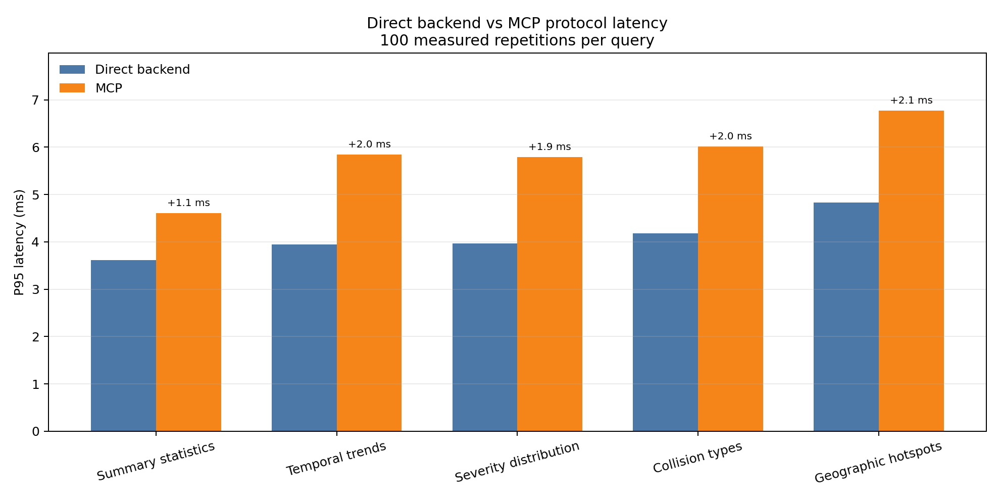

# MCP Communication Latency

Full DuckDB; 2 warm-ups and 100 measured repetitions per query. Overhead is the paired MCP latency minus direct latency.

The protocol comparison excludes LLM inference so it isolates MCP communication overhead. Real LLM latency is measured separately below using the production model, instructions, MCP server, backend, and fresh-session lifecycle.

| Query | Direct P50 (ms) | Direct P95 (ms) | MCP P50 (ms) | MCP P95 (ms) | Overhead P50 (ms) | Overhead P95 (ms) |
|---|---:|---:|---:|---:|---:|---:|
| Summary statistics | 3.507 | 3.612 | 4.483 | 4.602 | 0.971 | 1.127 |
| Temporal trends | 3.848 | 3.950 | 5.646 | 5.841 | 1.788 | 1.994 |
| Severity distribution | 3.863 | 3.964 | 5.621 | 5.787 | 1.768 | 1.938 |
| Collision types | 4.089 | 4.180 | 5.841 | 6.015 | 1.770 | 1.958 |
| Geographic hotspots | 4.708 | 4.831 | 6.632 | 6.772 | 1.937 | 2.103 |

## MCP Startup

Startup is measured independently over 100 new stdio sessions.

| Phase | P50 (ms) | P95 (ms) |
|---|---:|---:|
| Stdio transport open | 2.083 | 2.181 |
| MCP initialization | 179.657 | 182.734 |
| Tool discovery | 1.923 | 2.025 |
| Complete startup session | 183.725 | 186.849 |

## End-to-End Agent Latency

Model: `qwen3:4b-q4_K_M`. Each query uses a fresh production MCP session and 3 independent agent runs. Values are arithmetic means; P95 is not reported for this small sample. A run is valid only when it makes exactly two LLM calls, selects the expected tool and arguments, makes one MCP call, and returns the direct-backend result.

| Query | Valid runs | LLM calls | MCP startup (ms) | Tool selection LLM (ms) | Agent tool step (ms) | Final response LLM (ms) | Total through response (ms) |
|---|---:|---:|---:|---:|---:|---:|---:|
| Summary statistics | 3/3 | 6 | 242.7 | 7846.4 | 206.4 | 6088.3 | 14388.9 |
| Temporal trends | 3/3 | 6 | 278.8 | 16761.5 | 241.0 | 16026.0 | 33312.1 |
| Severity distribution | 3/3 | 6 | 317.5 | 8564.4 | 266.0 | 16367.3 | 25520.2 |
| Collision types | 3/3 | 6 | 315.4 | 7382.4 | 300.9 | 17105.2 | 25109.7 |
| Geographic hotspots | 3/3 | 6 | 354.1 | 9845.0 | 322.3 | 25760.7 | 36288.0 |

Measured **30 real LLM calls**; mean model-call latency was **13174.7 ms**. These LLM times are reported, but are not included in the direct-vs-MCP protocol comparison above.
